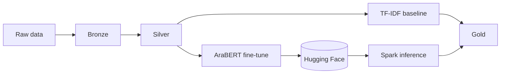
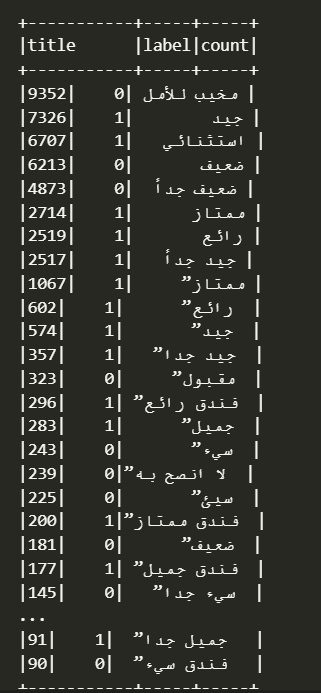
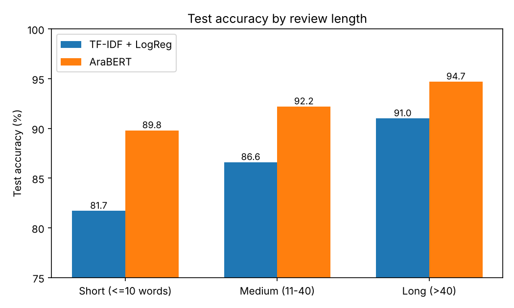
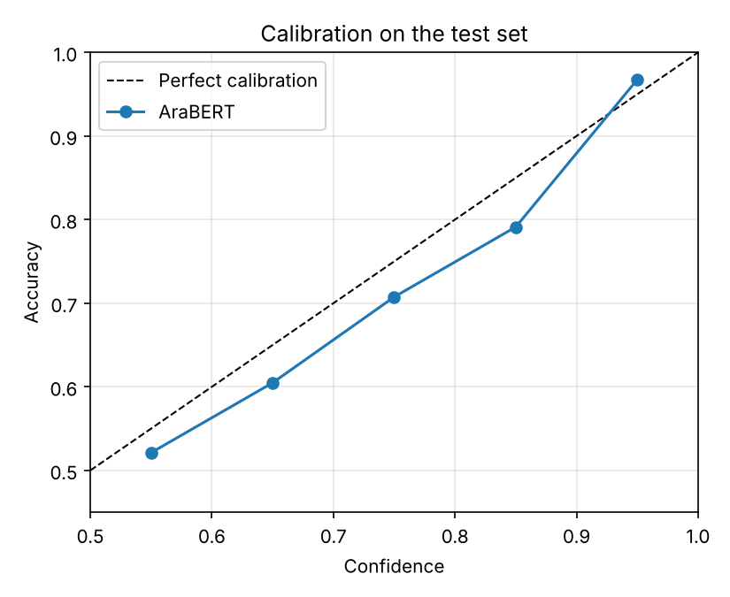
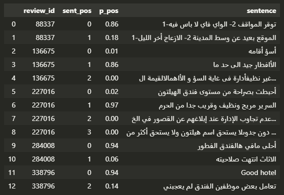
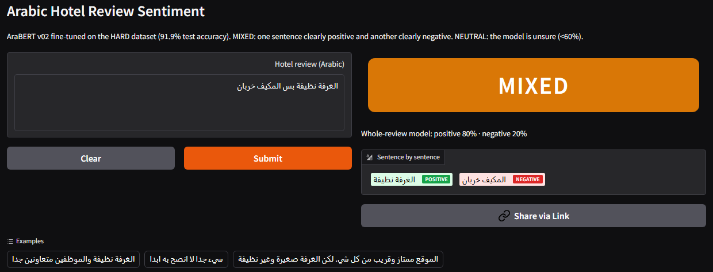
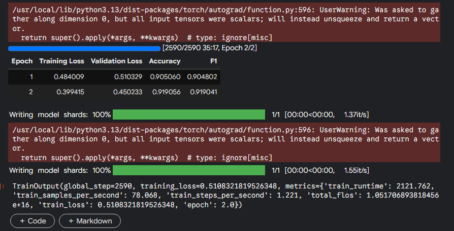
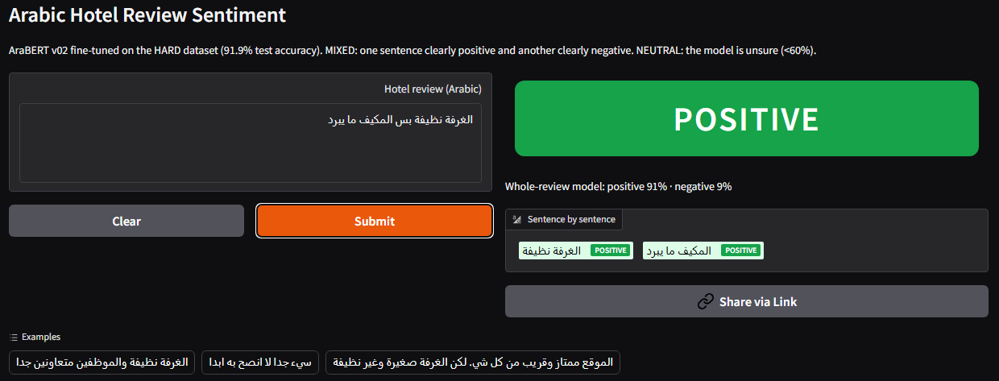

# Arabic Hotel Review Sentiment — PySpark Pipeline + Fine-tuned AraBERT

End-to-end sentiment analysis of Arabic hotel reviews: a PySpark medallion pipeline (bronze → silver → gold) prepares the data, a fine-tuned AraBERT model classifies it, and Spark runs the model as distributed batch inference.

**Model on Hugging Face:** [`Mahmoud-103/arabert-hard-sentiment`](https://huggingface.co/Mahmoud-103/arabert-hard-sentiment)  
**Live demo:** [Hugging Face Space](https://huggingface.co/spaces/Mahmoud-103/arabert-hard-sentiment-demo) — overall sentiment plus a sentence-by-sentence breakdown

| | Test accuracy |
|---|---|
| TF-IDF + logistic regression (Spark ML) | 85.76% |
| **AraBERT v02, fine-tuned** | **91.85%** |

AraBERT makes **~43% fewer errors** than the baseline (error rate 14.2% → 8.2%).

---

## Pipeline

| Stage | Notebook | What it does |
|---|---|---|
| Inspect | [`notebook/00_inspect.ipynb`](notebook/00_inspect.ipynb) | Inspect the raw file: encoding, delimiter, columns, types |
| Bronze | [`src/01_bronze.ipynb`](src/01_bronze.ipynb) | Load the raw data as-is with an explicit schema, add ingestion metadata, save as Parquet |
| Silver | [`src/02_silver.ipynb`](src/02_silver.ipynb) | Deduplicate, label sentiment from ratings, **remove label-leaking titles**, normalise Arabic text, split train / val / test |
| Baseline | [`src/03_baseline.ipynb`](src/03_baseline.ipynb) | TF-IDF + logistic regression in Spark ML, tuned on val; exports the splits for AraBERT and saves test predictions |
| Fine-tune | [`src/04_finetune_kaggle.ipynb`](src/04_finetune_kaggle.ipynb) | Fine-tune `aubmindlab/bert-base-arabertv02` on a Kaggle T4 GPU; push the model to the Hugging Face Hub |
| Inference | [`src/05_inference.ipynb`](src/05_inference.ipynb) | Batch-score the test set with the fine-tuned model on CPU, distributed with Spark `mapInPandas` |
| Gold | [`src/06_gold.ipynb`](src/06_gold.ipynb) | Join both models' test predictions; compare accuracy by review length, rating and user type; check calibration |
| Mixed sentiment | [`src/07_mixed.ipynb`](src/07_mixed.ipynb) | Score each sentence separately to label reviews positive / negative / mixed / neutral |

Shared Spark settings and data paths live in [`src/config.py`](src/config.py).



**Why Spark *and* PyTorch?** Spark handles the data work (cleaning, joins, splits) and the batch inference; PyTorch on a GPU handles training, since Spark DataFrames can't be trained on directly. Parquet is the hand-off between the two. At ~100k reviews pandas would also have been enough — the pipeline is built the scalable way on purpose, so the same code runs unchanged on far larger data.

---

## Label leakage: Booking.com titles

About **40% of reviews (42,102 of 104,028)** started with a title that Booking.com generates *from the score*, such as `استثنائي` (Exceptional) or `مخيب للأمل` (Disappointing). Each title maps almost perfectly to one label, so a model could score highly by reading the first word instead of the review.



These auto-titles were stripped in silver (keeping guest-written quoted titles like `“رائع”`, which are real opinion text). Every score in this README is measured **after** removal. Published HARD results that keep the titles are therefore not directly comparable.

---

## Results

All numbers are on the held-out test set (10,217 reviews, balanced positive / negative), which was not used for any tuning. Val and test scores differ by less than 0.7 points for both models, so neither was overfit to the validation set.

| Model | Val accuracy | Test accuracy |
|---|---|---|
| TF-IDF + logistic regression | 85.15% | 85.76% |
| AraBERT v02 (fine-tuned) | 91.91% | **91.85%** |

### Where AraBERT helps most



| Review length | Baseline | AraBERT | Gain |
|---|---|---|---|
| Short (≤10 words) | 81.7% | 89.8% | **+8.1** |
| Medium (11–40) | 86.6% | 92.2% | +5.6 |
| Long (>40) | 91.0% | 94.7% | +3.6 |

| Rating | Baseline | AraBERT |
|---|---|---|
| 1 ★ | 88.7% | 93.8% |
| 2 ★ | 82.5% | 88.2% |
| 4 ★ | 81.4% | 89.8% |
| 5 ★ | 93.5% | 98.3% |

- AraBERT wins in every segment, most of all on **short reviews**, where TF-IDF has few words to count.
- **2★ and 4★ reviews are hardest** for both models: they are often "good, but…" / "bad, but…".
- No meaningful difference across user types (couples 91.7%, solo travellers 91.2%).
- The baseline's most negative words include `سيئة`, `سيئه`, `سيء`, `سئ`, `سيئ` as separate features — spelling variants TF-IDF can't connect. AraBERT's subword tokenizer splits `سيئه` into `سيئ` + `##ه`.

### Calibration



| AraBERT confidence | Reviews | Accuracy |
|---|---|---|
| 0.5–0.6 | 307 | 52.1% |
| 0.6–0.7 | 334 | 60.5% |
| 0.7–0.8 | 441 | 70.8% |
| 0.8–0.9 | 728 | 79.1% |
| **0.9–1.0** | **8,407 (82%)** | **96.8%** |

Accuracy rises steadily with confidence. The model is slightly overconfident in the 0.5–0.9 bands (accuracy a few points below the stated confidence) and reliable in the top band. In practice this allows auto-labelling the 82% of reviews with ≥0.9 confidence at ~97% accuracy and routing the rest to a human.

---

## Mixed and neutral reviews

The model is trained on binary labels, but many reviews contain both praise and complaints. [`src/07_mixed.ipynb`](src/07_mixed.ipynb) splits each review into sentences (on punctuation and contrast words like `لكن`), scores every sentence with AraBERT, and applies rules:

- **mixed**: at least one sentence with P(positive) ≥ 0.8 **and** one with ≤ 0.2
- **neutral**: otherwise, review-level confidence < 0.6 (the near coin-flip zone in the calibration table)
- **positive / negative**: everything else



On the test set: positive 43% · negative 32% · **mixed 22%** · neutral 2%.

| Rating | % mixed |
|---|---|
| 1 ★ | 25% |
| 2 ★ | **32%** |
| 4 ★ | 20% |
| 5 ★ | **8%** |

Mixed reviews concentrate where expected (2★ highest, 5★ lowest). Unhappy guests mention positives much more often than happy guests mention negatives. Many HARD reviews appear to join Booking.com's separate "liked" / "disliked" fields, which makes them structurally mixed.

### Live demo

The [demo Space](https://huggingface.co/spaces/Mahmoud-103/arabert-hard-sentiment-demo) applies the same rules to any review. Here the guest praises the room and complains about the AC ("the room is clean, but the AC is broken"). The whole-review model leans positive (80%), but the sentence breakdown finds one clearly positive and one clearly negative part, so the verdict is **MIXED**.



---

## Training and inference



- **Fine-tuning:** 2 epochs on a Kaggle T4 ×2 GPU (~35 min), learning rate 2e-5, best epoch kept by val F1. Validation loss decreased from epoch 1 to 2 (0.510 → 0.450), so no sign of overfitting.
- **Batch inference:** Spark `mapInPandas` on a 16-core laptop CPU, 8 workers × 2 threads: **10,217 reviews in 9.7 min (17.6 reviews/s)**. Each worker loads the model once and predicts in mini-batches; Arrow moves data between Spark and Python in columnar chunks. Scaling out is a matter of adding workers or GPUs, with no code changes.

---

## Data

HARD (Hotel Arabic Reviews Dataset), balanced version: 105,698 Booking.com reviews in `balanced-reviews.txt` (tab-separated, UTF-16) with hotel name, rating, user type, room type, length of stay and review text.

| Step | Reviews |
|---|---|
| Raw | 105,698 |
| After deduplication | 104,028 |
| After title removal, normalisation, empty/duplicate removal | 103,255 |
| Split train / val / test | 82,821 / 10,217 / 10,217 |

The data is not included in this repository. Place the file at `data/raw/balanced-reviews.txt`.

> Elnagar, A., Khalifa, Y. S., & Einea, A. (2018). *Hotel Arabic-Reviews Dataset Construction for Sentiment Analysis Applications.* In Intelligent Natural Language Processing: Trends and Applications, Springer.

---

## Reproducibility note

The published results use the saved silver split. The split in `02_silver` is assigned with `F.rand(seed=42)` after a `dropDuplicates` shuffle; because row order after a shuffle isn't guaranteed, re-running the notebook can produce a different split. For future runs, a hash-based split keeps every review in the same set regardless of order:

```python
.withColumn("bucket", F.abs(F.xxhash64("review_id")) % 100)
.withColumn("split", F.when(F.col("bucket") < 80, "train").when(F.col("bucket") < 90, "val").otherwise("test"))
```

---

## Limitations

- Mixed / neutral labels are rule-based (thresholds 0.8 / 0.2 / 0.6) and checked against star ratings and manual examples, not against sentence-level ground truth.
- Labels come from star ratings, which are noisy (e.g. a 4★ review with mostly complaints).
- **Dialectal negation is a known weak spot.** The model recognises negative words in dialect (`المكيف خربان`, "the AC is broken" → negative), but misses negation built from `ما` + a neutral verb: `المكيف ما يبرد` ("the AC doesn't cool") is predicted positive, so the whole review is wrongly labelled POSITIVE instead of MIXED.

  
- Hotel reviews only; performance on other domains is untested.
- The HARD dataset has no stated license; the model is intended for research and educational use.

---

## Project layout

```
data/
  raw/       source file (not committed)
  bronze/    raw data as Parquet + ingestion metadata
  silver/    cleaned, labelled data split into train / val / test
  gold/      predictions from both models, joined for analysis
docs/images/ figures used in this README
notebook/    exploration
src/         pipeline steps and shared config
tools/       Windows Hadoop helpers (not committed)
```

## Setup

Requires Python 3.12 and Java 17+ (for PySpark).

```bash
python -m venv .venv
.venv\Scripts\activate        # Windows
pip install -r requirements.txt
```

On Windows, Spark needs Hadoop's `winutils.exe` and `hadoop.dll` to write files. Put both in `tools/hadoop/bin/`; `src/config.py` sets `HADOOP_HOME` to that folder automatically.

The inference notebooks download the model from the Hugging Face Hub on first run.
